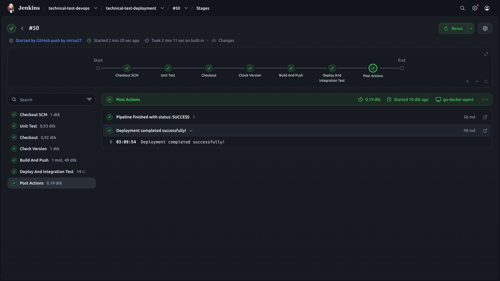
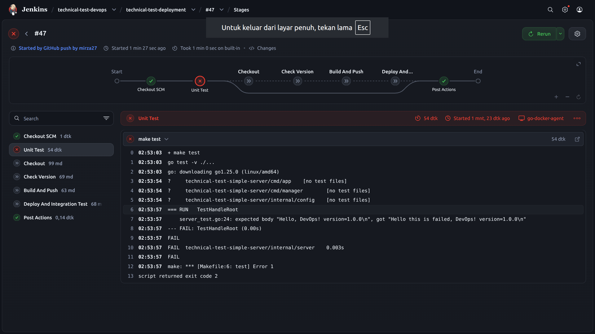
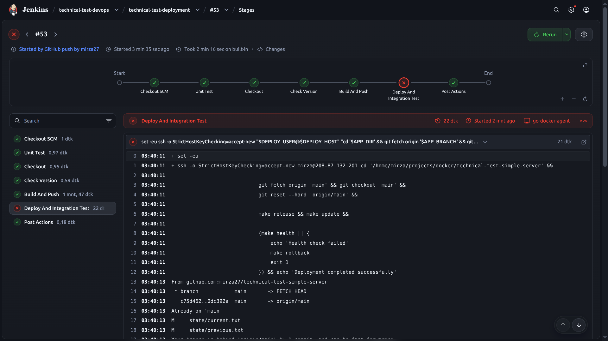

# Technical Test - Shift Engineer (DevOps)
PT Simple Journey Indonesia

This repository contains the containerization, zero-downtime hotfix mechanism, and CI/CD implementation for a simple Go HTTP server.

---

## Overview & Access

- **Application Name**: `technical-test-simple-server`
- **Docker Hub Repository**: [mirzarama27/technical-test-simple-server](https://hub.docker.com/repository/docker/mirzarama27/technical-test-simple-server)
- **Jenkins Server**: `https://jenkins.mmrh.me/`
  - Username: `user2`
  - Password: `password123!`
- **Target Host**: `208.87.132.201` (`mirza@208.87.132.201`)
- **Port Exposed**: `8080` (HTTP)

### Code Structure Adjustment
To keep the application clean and maintainable, the starter code was refactored into two dedicated packages under `internal/`:
- `internal/config/config.go`: handles port configuration and environment variable loading (`PORT`, default `8080`).
- `internal/server/server.go`: encapsulates routing and HTTP server lifecycle.
- `cmd/app/main.go`: minimal entrypoint that initializes config and runs the server.
- `cmd/manager/main.go`: lightweight supervisor that manages the server process and handles reload signals.

Most build, test, and deployment commands are aliased through the `Makefile` as shortcuts.

---

## Part I: Docker Build

### 1. Multi-Stage Dockerfile
The build uses a two-stage `Dockerfile`:
- **Stage 1 (Builder - `golang:1.26-alpine`)**:
  - Compiles a statically linked Go binary without CGO dependencies (`CGO_ENABLED=0 GOOS=linux GOARCH=amd64`).
  - Injects the application version at compile time using `-ldflags="-X main.version=${APP_VERSION}"`.
  - Compiles both `/app/server` (`./cmd/app`) and the supervisor `/tool/manager` (`./cmd/manager`).
- **Stage 2 (Runtime - `alpine:3.22`)**:
  - Copies only the compiled binaries `/app/server` and `/tool/manager`.
  - Sets `/tool/manager` as the container `ENTRYPOINT`.

### 2. Base Image Decision
`alpine:3.22` was selected over `scratch` or `distroless` because:
- The binary swap mechanism relies on basic Linux utilities (`ln`, `mv`, `sh`) inside the container.
- It allows running `docker exec` for operational debugging and hot-reloads while adding only ~5 MB over scratch.

### 3. Build Command
```bash
docker build --build-arg APP_VERSION=${VERSION} -t ${DOCKER_USERNAME}/${APP_NAME}:${VERSION} .
```
Shortcut:
```bash
make build
```
The `--build-arg APP_VERSION=${VERSION}` flag passes the target version string directly into the Go binary via `-ldflags`.

### 4. Image Size
- **Final Image Size**: `~19.6 MB`
```text
REPOSITORY                                 TAG     IMAGE ID       SIZE
mirzarama27/technical-test-simple-server   2.0.2   62fb83d81c3c   19.6MB
```
The image contains only Alpine's minimal root filesystem plus the two static Go binaries, omitting the entire Go compiler toolchain.

---

## Part II: Deployment & Hotfix (Zero-Downtime Swap)

### 1. How the Binary Swap Works
The deployment avoids rebuilding the full Docker container on small patches by using a process supervisor pattern:
1. **Supervisor Pattern**:
   The container runs `/tool/manager` (`cmd/manager/main.go`) as PID 1. It spawns `/app/server` as a child process and listens for OS signals.
2. **Generating the Patch Binary**:
   Running `make release` launches a temporary container from the newly built image, copies out the patched `/app/server` binary into the host's `./releases/${VERSION}/server` directory, and destroys the temporary container:
   ```bash
   make release
   ```
3. **Binding & Atomic Swap**:
   The running container mounts the host's `./releases` directory at `/releases`.
   Running `make update` triggers `scripts/update.sh`:
   - It links the new binary atomically inside the container:
     ```bash
     ln -s '/releases/<VERSION>/server' /app/server.next
     mv -Tf /app/server.next /app/server
     ```
   - It sends a `SIGUSR1` signal to the container:
     ```bash
     docker kill --signal=USR1 technical-test-simple-server
     ```
   - The supervisor receives `SIGUSR1`, gracefully stops the running `/app/server` child process with `SIGTERM`, and immediately spawns the new binary.
   - It tracks state by saving the previous version in `./state/previous.txt` and the new version in `./state/current.txt`.

### 2. Rollback Mechanism
If a newly deployed binary causes issues, `make rollback` (`scripts/rollback.sh`) reverses the symlink swap using the version recorded in `./state/previous.txt` and signals the supervisor to reload the previous working binary without restarting or deleting the container.

### 3. Benchmark & Verification
Live traffic was benchmarked using `scripts/test.sh`, which polled the endpoint every 250ms during an active swap:

From `docs/test.log`:
```text
========================================
[2026-10-18 21:13:14.261] Request: http://localhost:8080/
Hello, DevOps! version=1.0.1
HTTP Status: 200
Response Time: 0.000439s

========================================
[2026-10-18 21:13:14.517] Request: http://localhost:8080/
Hello, DevOps! version=1.0.2
HTTP Status: 200
Response Time: 0.000487s
```
The switch from version `1.0.1` to `1.0.2` completed in less than 256ms with zero dropped requests (HTTP 200 throughout).

### 4. Why This Approach Fits Production Hotfixes
- **Container remains intact**: The container, network namespace, and open port bindings never shut down, avoiding container recreation overhead.
- **Instant reload**: Reloading the child process via `SIGUSR1` happens in milliseconds.
- **Simple & lightweight**: Avoiding complex sidecar synchronization or heavy daemon architectures keeps the runtime predictable and easy to debug.

---

## Part III: CI/CD Pipeline (Jenkins)

The pipeline is defined in declarative syntax in `Jenkinsfile`.

### Pipeline Stages
1. **Unit Test**: Runs `make test` (`go test -v ./...`). If tests fail, the pipeline halts immediately, preventing broken code from building or deploying.
2. **Checkout**: Checks out the target branch from GitHub.
3. **Check Version**: Extracts the version string from `Makefile`.
4. **Build And Push**:
   - Executes `make build`.
   - Authenticates to Docker Hub using Jenkins credentials (`docker-hub-pat`).
   - Executes `make push`.
5. **Deploy And Integration Test**:
   - Connects to `208.87.132.201` via `sshagent` using private key credentials (`deploy-ssh`).
   - Syncs code on host: `git fetch origin main && git checkout main && git reset --hard origin/main`.
   - Extracts new binary: `make release`.
   - Swaps binary live: `make update`.
   - Runs integration health-check (`make health`).
   - **Automated Rollback**: If `make health` fails, the pipeline executes `make rollback` on the host before terminating with an exit code 1.

---

## Pipeline Evidence & Logs

### 1. Successful Pipeline Run (All Stages Green)
- **Jenkins URL**: [Pipeline Build #50](https://jenkins.mmrh.me/job/technical-test-devops/job/technical-test-deployment/50/stages/)
- **Screenshot**: `docs/success-pipeline.png`



### 2. Failed Pipeline Run (Unit Test Failure)
The pipeline stops at the **Unit Test** stage whenever any test fails, blocking image build and deployment.
- **Jenkins URL**: [Pipeline Build #47](https://jenkins.mmrh.me/job/technical-test-devops/job/technical-test-deployment/47/stages/)
- **Screenshot**: `docs/failed-pipeline.png`



### 3. Automated Rollback on Failed Health Check
If `scripts/health-check.sh` fails after `make update`, the deployment stage immediately invokes `scripts/rollback.sh`, restoring the prior binary from `./state/previous.txt`.
- **Jenkins URL**: [Pipeline Build #53 Console Log](https://jenkins.mmrh.me/job/technical-test-devops/job/technical-test-deployment/53/console)
- **Screenshot**: `docs/rollback-pipeline.png`



---

## Makefile Shortcut Cheatsheet

| Command | Description |
|---|---|
| `make test` | Runs Go unit tests (`go test -v ./...`) |
| `make build` | Builds Docker image with injected version |
| `make push` | Pushes image to Docker Hub |
| `make run` | Starts the container with volume mount (`./releases:/releases`) |
| `make release` | Extracts `/app/server` from image into `./releases/${VERSION}/server` |
| `make update` | Re-links binary inside running container and sends `SIGUSR1` reload signal |
| `make health` | Runs HTTP health check on target endpoint |
| `make rollback` | Restores previous binary version and sends `SIGUSR1` reload signal |
| `make test-reload` | Runs polling test script (`test.sh`) to observe zero-downtime swap |
| `make down` | Stops and removes container |
| `make logs` | Streams container logs |
